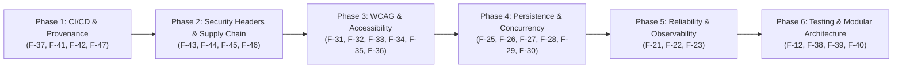

# Ouns / Players — Remediation Implementation Plan

> **Scope:** Remediation of all 46 active findings (5 Medium, 41 Low, 0 High/Critical) identified in the 11-Phase Audit Report (commit `49de07a`).  
> **Target Architecture:** Pure static Astro 7.4.11 on Cloudflare Workers Static Assets.  
> **Status:** Active / In Progress.

---

## 1. Executive Phasing Strategy

The remediation is sequenced across **6 discrete, verifiable phases** designed to eliminate high-leverage security risks first, followed by accessibility, persistence hygiene, reliability, and modular code architecture.



---

## 2. Phase 1: CI/CD Pipeline & Dependency Provenance (Immediate)

### Objectives
- Prevent untested code from merging to `main`.
- Pin all GitHub Actions to immutable commit SHAs with minimal permissions.
- Resolve lockfile packages cleanly to the canonical npm registry.
- Establish automated dependency patch tracking.

### Findings Addressed
| Finding | Severity | Target File(s) | Summary |
|---|---|---|---|
| **F-37** | Low | `.github/workflows/deploy.yml` | Add `pull_request` trigger with decoupled test/deploy jobs |
| **F-41** | **Medium** | `.github/workflows/deploy.yml` | SHA-pin all Actions; enforce `permissions: contents: read` |
| **F-42** | Low | `package-lock.json` | Re-resolve 57 `registry.npmmirror.com` entries back to `registry.npmjs.org` |
| **F-47** | Low | `.github/dependabot.yml` | Add Dependabot configuration for GitHub Actions and npm dependencies |

### Detailed Implementation Steps

#### 1.1 Hardening `.github/workflows/deploy.yml` (F-37, F-41)
Refactor the workflow into two separate jobs:
1. `validate` (runs on `pull_request` to `main`, `push` to `main`, and `workflow_dispatch`):
   - Permissions: `contents: read`
   - Actions SHA-pinned:
     - `actions/checkout@v4` &rarr; `actions/checkout@11bd71901bbe5b1630ceea73d27597364c9af683` (# v4.2.2)
     - `actions/setup-node@v4` &rarr; `actions/setup-node@39370e3970a6d050c480ffad4ff0ed4d3fdee5af` (# v4.1.0)
   - Steps: `npm ci`, `npm run lint`, `npm test`, `npm run build`.
2. `deploy` (runs only on `push` to `main` or manual trigger after `validate` succeeds):
   - Action SHA-pinned:
     - `cloudflare/wrangler-action@v3` &rarr; `cloudflare/wrangler-action@68d9f104d412bf2541a774619a9735d55b0a3407` (# v3.14.0)
   - Steps: `wrangler deploy`.

#### 1.2 Lockfile Clean Re-resolution (F-42)
- Re-install using standard npm registry configuration:
  ```bash
  npm install --package-lock-only --registry=https://registry.npmjs.org
  ```
- Verify zero occurrences of `registry.npmmirror.com` in `package-lock.json`.
- Verify `npm audit` remains clean at 0 vulnerabilities.

#### 1.3 Dependabot Setup (F-47)
Create `.github/dependabot.yml`:
- Package ecosystems: `npm` (weekly) and `github-actions` (weekly).
- Target directory: `/`.

---

## 3. Phase 2: Security Response Headers, External Trust Surface & Privacy

### Objectives
- Enforce defence-in-depth HTTP security headers on Cloudflare Workers Static Assets.
- Constrain YouTube runtime script injection via Content Security Policy (CSP).
- Pin external Mushaf fallback assets to immutable commit SHAs.
- Provide transparent user privacy notices for IP/GPS geocoding requests.

### Findings Addressed
| Finding | Severity | Target File(s) | Summary |
|---|---|---|---|
| **F-44** | Low | `public/_headers` | Add CSP, HSTS, X-Content-Type-Options, Referrer-Policy, Permissions-Policy |
| **F-43** | **Medium** | `public/_headers`, `src/scripts/app.js` | Restrict YouTube loader via CSP; pass origin & restrict DOM access |
| **F-45** | Low | `src/scripts/app.js` | Pin mushaf fallback URLs from `@main` to specific commit SHAs |
| **F-46** | Low | `src/scripts/app.js`, `src/components/Modals.astro` | Consolidate IP-geo chain; add location privacy disclosure |

### Detailed Implementation Steps

#### 2.1 Static Security Headers (F-44, F-43)
Create `public/_headers` (deployed by Astro into `dist/_headers`):
```text
/*
  X-Content-Type-Options: nosniff
  X-Frame-Options: SAMEORIGIN
  Referrer-Policy: strict-origin-when-cross-origin
  Permissions-Policy: geolocation=(self), camera=(), microphone=(), payment=()
  Strict-Transport-Security: max-age=31536000; includeSubDomains; preload
  Content-Security-Policy: default-src 'self'; script-src 'self' 'unsafe-inline' https://www.youtube.com https://s.ytimg.com; style-src 'self' 'unsafe-inline'; img-src 'self' data: blob: https://i.ytimg.com https://cdn.jsdelivr.net https://raw.githubusercontent.com; media-src 'self' blob: https://*.mp3quran.net https://cdn.islamic.network; connect-src 'self' https://mp3quran.net https://*.mp3quran.net https://api.alquran.cloud https://api.aladhan.com https://api.open-meteo.com https://nominatim.openstreetmap.org https://api.bigdatacloud.net https://get.geojs.io https://ipwho.is https://ipapi.co https://cdn.jsdelivr.net https://raw.githubusercontent.com; frame-src https://www.youtube.com https://www.youtube-nocookie.com;
```

#### 2.2 Mushaf Fallback SHA Pinning (F-45)
In `src/scripts/app.js` (lines 535–544):
- Replace mutable branch tags (`@main` and `/main/`) with verified immutable commit SHAs for:
  - `Younes12345698/pro-muslim-mushaf`
  - `SakinaDevGroup/mushaf-madani-cdn`
  - `quran-ws/quran-svg`

#### 2.3 Privacy Disclosure & Geolocation Consent (F-46)
- Add a subtle informational note in the Prayer Location modal explaining that geolocation requests query public geo-IP lookup services (`geojs.io` / `ipwho.is`) to compute prayer times.
- Ensure GPS coords passed to `api.bigdatacloud.net` are truncated to 3 decimal places (~100m precision) before transmission.

---

## 4. Phase 3: Accessibility (WCAG 2.1 AA), i18n & Contrast

### Objectives
- Bring all overlay layers up to WCAG 2.4.3 (Focus Order) and 4.1.2 (Dialog Semantics).
- Ensure 100% of interactive toggles reflect their state via ARIA attributes.
- Fix low-contrast elements on the light theme.
- Eliminate hardcoded English accessibility labels.

### Findings Addressed
| Finding | Severity | Target File(s) | Summary |
|---|---|---|---|
| **F-31** | **Medium** | `src/components/Modals.astro`, `src/scripts/app.js` | Add `role="dialog"`, `aria-modal`, focus traps, and Escape close for `confirmScrim` |
| **F-32** | Low | `src/components/Modals.astro`, `src/scripts/app.js` | Add `aria-pressed` / `aria-checked` to segmented controls and toggles |
| **F-33** | Low | `src/components/*.astro` | Replace hardcoded English `aria-label`s with `data-i18n-aria` |
| **F-34** | Low | `src/scripts/app.js`, `src/components/` | Add `<bdi>` and `dir="auto"` wrappers for mixed-direction interpolations |
| **F-35** | Low | `src/styles/global.css` | Define high-contrast `--focus-ring` (pass WCAG 1.4.11 3:1 on light theme) |
| **F-36** | Low | `src/pages/index.astro`, `src/scripts/app.js` | Add `role="status"` and `aria-live="polite"` to `#toasts` container |

---

## 5. Phase 4: Client-Side Persistence, Concurrency & State Integrity

### Objectives
- Establish an explicit storage schema version and formal migration pipeline.
- Validate all incoming values from `localStorage` defensively before consuming them.
- Eliminate light-theme flash on initial page load (FOUC).
- Synchronize state changes across concurrent browser tabs.
- Ensure browser notification permissions are handled asynchronously and accurately reflect state.

### Findings Addressed
| Finding | Severity | Target File(s) | Summary |
|---|---|---|---|
| **F-25** | Low | `src/scripts/app.js` | Await `Notification.requestPermission()`; reconcile UI toggle state |
| **F-26** | Low | `src/scripts/app.js` | Implement `ouns_schema_version`, central migration runner, remove orphaned keys |
| **F-27** | Low | `src/scripts/app.js` | Implement read-side type validation schemas for `store.get` |
| **F-28** | Low | `src/scripts/app.js` | Surface `QuotaExceededError` via toast rather than silent empty catch |
| **F-29** | Low | `src/scripts/app.js` | Listen for `storage` events across tabs; throttle session persistence |
| **F-30** | Low | `src/layouts/Base.astro` | Pre-paint restore `ouns_theme` in `<head>` script to avoid light flash |

---

## 6. Phase 5: Reliability, Observability & Service Worker Hygiene

### Objectives
- Establish client-side runtime error monitoring without third-party external trackers.
- Guard Service Worker cache upgrades against breaking open tabs.
- Unify retry, backoff, and network timeout handling across the entire app.

### Findings Addressed
| Finding | Severity | Target File(s) | Summary |
|---|---|---|---|
| **F-21** | **Medium** | `src/layouts/Base.astro`, `src/scripts/lib/telemetry.js` | Add sampled runtime error listener (`window.onerror` / `unhandledrejection`) |
| **F-22** | Low | `public/sw.js` | Avoid purging active version caches immediately while tabs are open |
| **F-23** | Low | `public/sw.js`, `src/scripts/app.js` | Align SW fetches with timeout/backoff; add `online`/`offline` listeners |

---

## 7. Phase 6: Testing, Code Architecture & QA Gating

### Objectives
- Guard calculations against NaN in prayer time computations.
- Achieve 100% test coverage over sacred Quran metadata (`surah.js`).
- Introduce code coverage measurement into CI.
- Break down the 1,884-line monolithic `app.js` into modular, unit-testable libraries.

### Findings Addressed
| Finding | Severity | Target File(s) | Summary |
|---|---|---|---|
| **F-12** | Low | `src/scripts/lib/prayer.js` | Guard calculations against NaN; validate input strings |
| **F-39** | Low | `tests/surah.test.mjs` | Add full test suite covering all 114 Surah entries |
| **F-40** | Low | `tests/prayer.test.mjs`, `package.json` | Add negative test cases for prayer times; configure test coverage |
| **F-38** | **Medium** | `src/scripts/lib/*.js`, `src/scripts/app.js` | Extract pure domain logic (queue, audio picker, storage) out of `app.js` |
